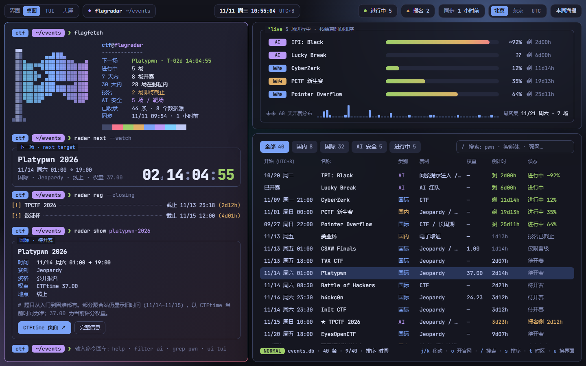
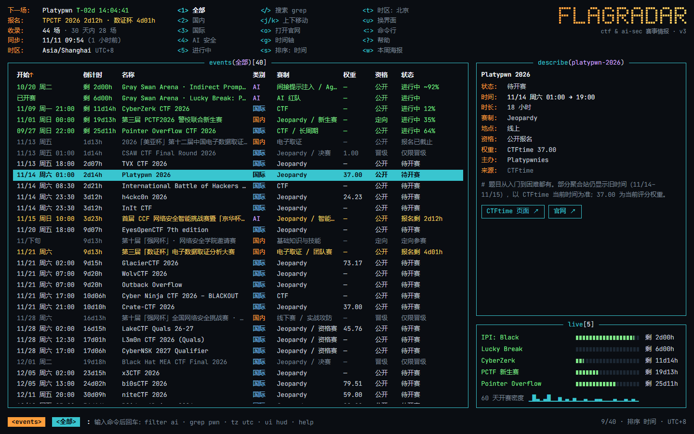
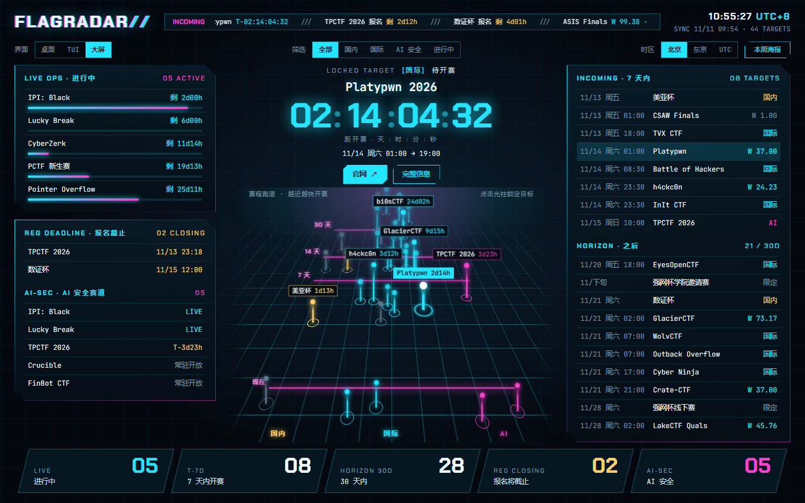

# FLAGRADAR

近期 CTF、国内网络安全赛事、AI 安全 / 智能体挑战赛的赛事日历。给高校 CTF 战队用：打开就能看到最近有什么比赛、还有多久开赛、报名什么时候截止。

**在线地址**：https://mxliu2026-dotcom.github.io/flagradar/ ・ 海报页：[weekly.html](https://mxliu2026-dotcom.github.io/flagradar/weekly.html)



## 功能

- **三套界面，一键切换**（左上角「界面」或键盘 `u`，也可以用 `?ui=rice|tui|hud` 直达）
  - 桌面：平铺窗口风格，带一个能敲命令的终端（输入 `help`）
  - TUI：k9s 风格的表格 + 详情面板，`g` 切到时间轴视图，`:` 进命令行
  - 大屏：倒计时 + 透视「赛程跑道」，越靠近的光柱越快开赛
- **倒计时与报名截止提醒**：下一场比赛、进行中的比赛进度、即将截止的报名
- **筛选与搜索**：国内 / 国际 / AI 安全 / 进行中；按时间或 CTFtime 权重排序
- **时区切换**：北京 / 东京 / UTC
- **键盘优先**：`j/k` 移动、`/` 搜索、`1–5` 分类、`s` 排序、`t` 时区、`o` 打开官网
- **本周速览海报**：按当天日期取未来 7 天的比赛，手机截图即可发群
- **手机可用**：窄屏下自动变成单列和两行卡片

| TUI | 大屏 |
| --- | --- |
|  |  |

## 数据从哪来

赛事数据由 Claude 的定时任务自动巡检更新，时间与报名信息以各赛事官网为准。

- 云端任务（每周一、三、五）：CTFtime、Bugku 赛事中心、国内赛事日历、Gray Swan 等 AI 红队平台，加上中英文搜索
- 本机任务（每周一、三、五、日）：在搜狗微信搜索里查公众号的比赛推文，核实后补充国内赛，并把最新数据推到本仓库
- 录入规则：不编造。只有日期没有时刻的标为「时刻待公布」，只有单一来源的标为「待核实」

## 实现

纯静态站点，无构建步骤、无第三方依赖，托管在 GitHub Pages。

| 文件 | 作用 |
| --- | --- |
| `Main.dc.html` `Weekly.dc.html` | 页面本体：模板、样式、逻辑和赛事数据都在里面。更新网站只需要替换这两个文件 |
| `index.html` `weekly.html` | 外壳，很少改动 |
| `boot.js` | 取回页面文件，拆出样式、模板和逻辑并挂载 |
| `rt.js` | 约 230 行的模板运行时：`{{ }}` 取值、循环、条件、事件绑定、按位置复用 DOM 节点 |

几个设计取舍：

- **页面文件就是数据文件**。赛事 JSON 内嵌在页面里的两个标记之间，定时任务只替换这一段，界面代码不会被碰到；同一份页面文件同时用于设计画布和这个公开站点，不需要维护两套。
- **三套界面共用一份逻辑**。筛选、排序、选中、倒计时只算一次，三套模板各取所需，切换界面不丢状态。
- **跑道是 CSS 3D，不是 canvas**。光柱是真实的按钮，能点、能用键盘聚焦；标签位置在渲染前做了碰撞检测，避免互相遮挡。
- **字体回退先等宽**。网络字体没加载完时用系统等宽字体，中文直接用系统字体，国内访问不用等一个很大的字体样式表。

## 本地预览

页面通过 `fetch` 读取文件，直接双击打开不行，需要起一个本地服务：

```bash
python -m http.server 8000
# 然后访问 http://localhost:8000/
```

## 署名

界面设计与代码实现由 Claude（Anthropic）完成，项目需求、方向取舍和验收由 [@mxliu2026-dotcom](https://github.com/mxliu2026-dotcom) 负责。

## License

[MIT](LICENSE)
